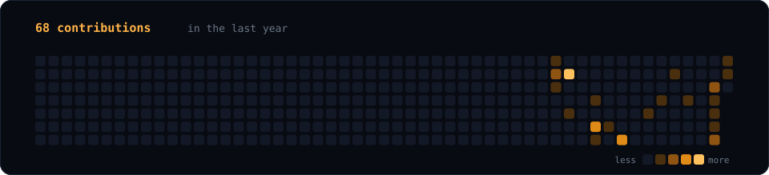

  

I'm an engineering student who likes building small tools that work: CLI utilities and automation in Python, C and C++. I'm sharpening my algorithms and data structures, and learning C++ graphics with OpenGL and GLFW. My long-term goal is to simulate a black hole using real relativistic physics.

  

## Featured projects

**[Price Drop Tracker Bot](https://github.com/Amineimmo/price-drop-tracker-bot)**
Python automation bot that tracks product prices and alerts me when they drop.

**[PDFMate](https://github.com/Amineimmo/PDFMate)**
Python CLI utility for processing and converting PDFs.

**[Hex Viewer V1](https://github.com/Amineimmo/Hex-viewer-V1)**
C command-line tool for inspecting binary files in hex and ASCII.

## Activity

  

## Contact

- Email: [aminemestro@gmail.com](mailto:aminemestro@gmail.com)
- LeetCode: [aminebouha](https://leetcode.com/u/aminebouha/)
